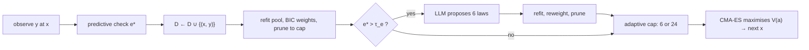
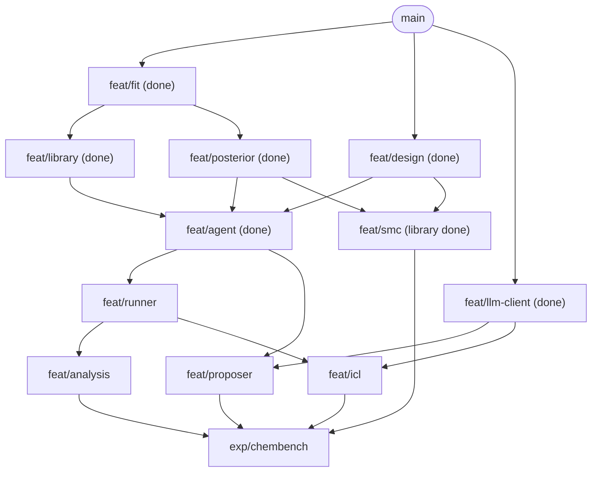

# Implementation blueprint

This blueprint lists what remains to reproduce the Model Discovery Agent (MDA) experiment on ChemBench ([arXiv:2608.09696v5](https://arxiv.org/abs/2608.09696), §4.1 and App. B), and which branch implements each part. [chembench-spec.md](./chembench-spec.md) gives the paper's settings and our defaults where the paper is silent (D1–D20); this file refers to it as "spec §n".

**In scope:**

- the primary MDA arm (hybrid seed library + LLM, BIC weights, CMA-ES design);
- the fixed-library, random-design, fixed-scale-BIC and SMC controls;
- both ICL baselines;
- pass rates and nMSLE curves that can be compared with the paper.

**Out of scope:**

- GlucoseBench, NeuronBench and BoxingGym;
- particle filters and synthetic likelihoods, which only latent dynamics need;
- rerunning LLM-AutoSciLab ([api-cost-estimation.md](./api-cost-estimation.md) explains why).

## Current state

This is `main` with `feat/fit`, `feat/library`, `feat/posterior`, `feat/design`, `feat/llm-client` and `feat/agent` merged, plus the library part of `feat/smc`.

| Module | Contents | Merged in |
| --- | --- | --- |
| `mda.bench` | `World` (`observe`, `truth`, `heldout`), `to_unit` and `from_unit`, benchmark constants | `feat/chembench` (#1) |
| `mda.metrics` | `rmsle`, `nmsle`, `passed` | `feat/chembench` (#1) |
| `mda.arrays` | jaxtyping aliases | `feat/chembench` (#1), `feat/posterior` |
| `mda.hypothesis` | `Hypothesis`, `Param`, `Model`, `compile_hypothesis`, `normalise_expr`, `parse_hypotheses` | `feat/hypothesis` (#4), `feat/fit` (#8), `feat/posterior` |
| `mda.fit` | `fit` and `FitResult`, `sigma`, `residuals`, `relative_residuals`, `residual_input_spearman` | `feat/fit` (#8) |
| `mda.library` | `SEED_LIBRARY`, the 9 seed laws with the D7 bounds, and `SEED_BY_WORLD`, mapping each canonical world to its seed | `feat/library` (#9) |
| `mda.pool` | `Candidate`, `Origin` and `Pool`: `add` with exact-expression dedupe, `refit`, `keep`, and the per-model arrays `rss`, `n_free` and `fit_err` | `feat/posterior` |
| `mda.posterior` | `bic_profiled`, `bic_fixed`, `log_prior`, `log_weights`, `weights`, `prune_top`, `adaptive_cap` | `feat/posterior` |
| `mda.design` | `between_model_variance`, `cma_design`, `random_design` | `feat/design` |
| `mda.smc` | `tempered_smc` and `SMCResult`, `log_likelihood`, `particle_predictor`, `log_model_weights`. Not yet used by an arm | `feat/smc` |
| `mda.llm` | `LLMClient` (the provider-neutral base), `ClaudeLLM`, `FakeLLM`, `Reply`, `StopReason`, `Usage`, `Pricing`, `ReplyCache`; `HYPOTHESES_SCHEMA` in `mda.hypothesis` | `feat/llm-client` |
| `tools/llm_check.py` | Counts proposer-prompt tokens, or makes one real call | `feat/llm-client` |
| `mda.config` | `MDAConfig`, every hyperparameter with its source, and `DEFAULTS`, from which the other modules read their keyword defaults | `feat/agent` |
| `mda.propose` | The `Proposer` protocol, `Proposal`, `CallRecord` and `NullProposer` | `feat/agent` |
| `mda.agent` | `MDAAgent` (Alg. 2): `design`, `update_state`, `get_model`, `get_predictor` | `feat/agent` |
| `mda.run` | `run_cell` (Alg. 1), `RunLog` and its JSON format, `passive_design`, `query_set` | `feat/agent` |
| `prompts/chem_propose.txt` | The proposer prompt, verbatim from App. G.1 | — |
| CI | pre-commit, ty, and pytest on Python 3.12 and 3.13 | `dev/ci` (#2), `dev/ty` (#3) |
| Tooling | ty as a pre-commit hook, and the Development section of the README | `dev/ty-precommit` (#5) |

## Target layout

```text
src/mda/
  bench.py, metrics.py, arrays.py, hypothesis.py, fit.py, library.py   done
  pool.py, posterior.py, design.py                                     done
  config.py     feat/agent        MDAConfig: every hyperparameter, each citing the paper or a D-number (done)
  agent.py      feat/agent        MDAAgent: init, design, update_state, get_model, get_predictor (Alg. 2) (done)
  propose.py    feat/agent        Proposer protocol and NullProposer (done)
                feat/proposer     LLMProposer: prompt rendering, parse, dedupe, retry
  llm.py        feat/llm-client   LLM clients, reply cache, transcripts, usage and cost (done)
  run.py        feat/agent        run_cell: Alg. 1 for one (world, seed), with a JSON run log (done)
                feat/runner       grid over worlds × seeds × arms, CLI, resume, manifest
  smc.py        feat/smc          tempered-SMC evidence (control arm); the library is done, the arm is not
  icl.py        feat/icl          ICL (+MDA design) and ICL (+LLM design)
  analysis.py   feat/analysis     aggregation, world bootstrap, figures and tables
configs/        frozen arm configs (feat/runner, exp/chembench)
runs/, cache/   generated run logs and LLM replies; git-ignored
```

One `update_state` call, in the primary arm:



## Branch plan



There are three tracks, which can proceed in parallel:

- **Numerics:** `feat/fit`, `feat/library`, `feat/posterior`, `feat/design` and `feat/agent` (done) → `feat/runner`.
- **LLM:** `feat/llm-client` (done). `feat/proposer` can start now.
- **Evaluation:** `feat/analysis` and `feat/icl` build on the run-log schema from `feat/agent`, which is fixed: `mda.run.RunLog`, schema 1. The library part of `feat/smc` is done; its arm waits for `feat/runner`.

| # | Branch | Scope | Depends on | Milestone |
| --- | --- | --- | --- | --- |
| 1 | `feat/fit` (done) | Bounded multistart least squares and residual diagnostics | main | M1 |
| 2 | `feat/library` (done) | The 9 canonical seed laws | `feat/fit` | M1 |
| 3 | `feat/posterior` (done) | Pool, BIC, weights, pruning, adaptive cap | `feat/fit` | M1 |
| 4 | `feat/design` (done) | $V(a)$, CMA-ES, random design | main | M1 |
| 5 | `feat/agent` (done) | MDA agent loop, predictive check, one-cell runner | 2, 3, 4 | M1 |
| 6 | `feat/runner` | Grid runner, CLI, arm configs | 5 | M1 |
| 7 | `feat/llm-client` (done) | LLM clients, reply cache, cost accounting | main | M2 |
| 8 | `feat/proposer` | LLM proposer and the hybrid arm | 5, 7 | M2 |
| 9 | `feat/analysis` | Aggregation, bootstrap, figures | 6 | M3 |
| 10 | `feat/icl` | ICL baselines | 6, 7 | M3 |
| 11 | `feat/smc` (library done) | Tempered-SMC control | 3, 4; the arm also 5, 6 | M3 |
| 12 | `exp/chembench` | Frozen configs, full runs, results write-up | 8, 9, 10, 11 | M4 |

### 1. `feat/fit` (done)

- **Scope.** `mda/fit.py`, as built:
  - `sigma(y)`: the whitening scale $\max(0.03\lvert y\rvert, 0.01)$.
  - `residuals(y, y_hat, residual)`: the residuals whose squares sum to the RSS, `"whitened"` by default or `"log1p"` (D1).
  - `fit(h, X, y, *, rng, n_starts, warm_start, residual, f)` → `FitResult(theta, rss, y_hat, ok)`, using bounded multistart `scipy.optimize.least_squares` (spec §3, D8). A parameter with `low > 0` whose bounds span more than two decades is optimised, and its starts are drawn, in log space. One with `low == high` is held fixed. `f` takes an already compiled hypothesis, so that a refit does not compile it again.
  - `relative_residuals(y, y_hat, c)` (D5).
  - `residual_input_spearman(X, y, y_hat)`: the residual–input Spearman correlations used in the prompt (D6), one per input in the order of `INPUT_NAMES`. A correlation is 0 when the input or the residual is constant, and all seven are NaN when any residual is non-finite.
  - `Model`, the type of a compiled hypothesis, added to `mda/hypothesis.py`.
- **Constants.** $\rho$, $\sigma_{\mathrm{floor}}$, $c$ and the two-decade threshold were module constants of `mda/fit.py`. Since `feat/agent` they are the `MDAConfig` fields `rho`, `sigma_floor`, `rel_floor` and `log_span`, and `fit` and `residuals` take $\rho$, $\sigma_{\mathrm{floor}}$ and the threshold as arguments.
- **Dependencies.** `scipy`, added with `uv add`.
- **Tests.** `tests/test_fit.py` covers the five cases planned for this branch, then the starts and the error handling:
  - Recovers known constants from noiseless Michaelis–Menten and Hill data.
  - Never leaves the bounds.
  - Non-finite predictions give `ok=False` and `rss=inf` instead of raising.
  - Deterministic for a given RNG; a warm start is used when given.
  - The all-zero $D_0$ of the activator worlds (`c67`, `c78`, `c92`) does not crash.
  - Starts for wide bounds are drawn in log space, random starts rescue a stuck warm start, and ties go to the warm start.
  - Linear-space parameters raise no warnings, and caller errors raise instead of returning `ok=False`.
- **Measured.** A seed law fits on 25 points in tens of milliseconds: about 40 ms at the median, with 8 random starts and a warm start.

### 2. `feat/library` (done)

- **Scope.** `mda/library.py`, as built:
  - `SEED_LIBRARY`: a tuple of the 9 `Hypothesis` objects in spec §2, with the D7 bounds as module constants (`KCAT`, `K_MM`, `HILL_N`, `EA`).
  - `SEED_BY_WORLD`: a read-only mapping from each canonical world ID to its seed, in the order of `canonical_worlds()`.
  - The parameter names are the vendored oracle's, so fitted values compare with a world's constants by name.
- **Tests.** `tests/test_library.py`:
  - All 9 compile, and their names and expressions are unique.
  - Each canonical world's `v0`/medium constants fall within the bounds. This checks the bounds; it is not used to tune them.
  - Each seed at its world's constants reproduces `World.truth`.
  - Fitting each seed to 25 noiseless `World.truth` points (8 random starts) gives RMSLE < 0.05 on `heldout(42, 1000)`.
- **Done when** the fixed-library arm can represent all 9 canonical worlds.

### 3. `feat/posterior` (done)

- **Scope.** As built:
  - `mda/pool.py`:
    - `Candidate`: a hypothesis, its compiled function, its dedupe key, its `origin` (the enum `Origin`: `SEED`, `INIT` or `EXPAND`), `added_at` (the number of observations $B$ when it was added), its fit, and `fit_err`, the in-sample median relative residual of that fit. `n_free` is $C_m$: the parameters with `low < high` (D20).
    - `Pool.add(hypotheses, origin, added_at=B)`: drops exact-expression duplicates (D13), both of the pool and within the batch, and returns the candidates it added. They have no fit until the next `refit`.
    - `Pool.refit(X, y, rng=...)`: fits every candidate to all the data, with 8 random starts and a warm start from the candidate's previous estimate (D8).
    - `Pool.keep(indices)` removes the other candidates. The per-model arrays `rss`, `n_free` and `fit_err` follow the pool order; `rss` and `fit_err` raise while a candidate has no fit.
  - `mda/posterior.py`, which works on per-model arrays and does not import `Pool`:
    - `bic_profiled` with the RSS floor (D2), `bic_fixed`, and `log_prior(n_params, lam)`.
    - `log_weights` and `weights`: the softmax of $-\mathrm{BIC}_m / 2 + \log p(m)$ and its logarithm (spec §3).
    - `prune_top(log_w, n)` returns the indices of the kept models, in pool order, and their renormalised log weights. It ranks log weights because a weight far behind the best underflows to exactly 0, which is routine under the fixed-scale BIC. Ranking the weights would then drop models by pool position, the newest proposals first, instead of by fit.
    - `adaptive_cap(w, fit_err)` returns 6 or 24 (spec §4).
  - `normalise_expr` in `mda/hypothesis.py`: the dedupe key. It shares the comment and whitespace handling of `compile_hypothesis`.
  - Models with non-finite RSS get BIC = inf and weight 0, and are pruned first. When no model has a finite RSS, every weight is 0.
- **Constants.** `N_STARTS` in `mda/pool.py`, and `RSS_FLOOR`, `TAU_C`, `TAU_FIT`, `N_MIN` and `N_MAX` in `mda/posterior.py`, were module constants. Since `feat/agent` they are the `MDAConfig` fields `n_starts`, `rss_floor`, `tau_c`, `tau_fit`, `n_min` and `n_max`. The functions take them as arguments.
- **Tests.** `tests/test_posterior.py`, `tests/test_pool.py` and the `normalise_expr` cases in `tests/test_hypothesis.py` cover the six cases planned for this branch, then the pool's bookkeeping:
  - BIC values against hand computation.
  - Weights sum to 1, and their order is consistent with BIC.
  - $\mathrm{RSS} = 0$ does not produce NaN: exact fits tie, and the parameter count decides between them.
  - Pruning keeps the largest weights. Non-finite models go first, even among weights that underflow to 0.
  - The cap thresholds behave correctly just above and below 0.9 and 0.05.
  - Dedupe ignores formatting but treats a renamed parameter as a new expression.
  - `n_free` leaves out fixed parameters, and a law with one held fixed is ahead of the same law with it free by $\sqrt{N}$.
  - `refit` is deterministic for a given RNG, warm-starts from the previous estimate, and leaves the pool unchanged when a fit raises.
  - On 25 observations of `c1_competitive_inhibition`, the seed pool's weights match Alg. 9 written out per model for both BIC variants, the true seed has weight above 0.99, and the cap drops to 6.
- **Measured.** Refitting the 9 seeds on 25 points takes about half a second.
- **Done when** `Pool.refit(D)` followed by `weights` reproduces Alg. 9 for both BIC variants.

### 4. `feat/design` (done)

- **Scope.** `mda/design.py`, as built:
  - `between_model_variance(U, weights, predictors, *, space)`: $V(a)$ for a batch of unit-box designs (spec §6). It maps `U` to natural units with `from_unit` and compares the predictions on the raw rate by default, or on $\log(1 + y)$ (D9). It takes the weights and one predictor per model, a callable from conditions to rates, and does not import `Pool`, so the SMC control can pass predictors that average over particles. Models with weight 0 are skipped. $V$ is NaN where it is undefined: where a model with positive weight predicts a non-finite value, or where $V$ overflows. An unknown `space` raises `ValueError` before any model is evaluated.
  - `cma_design(weights, predictors, *, rng, n_evals=48, sigma0=0.3, space)` returns the next condition in natural units (D10). pycma runs with its termination criteria ignored, so it always makes exactly `n_evals` evaluations; with the default population of 9, the sixth generation is cut to 3 points and not told to pycma. It returns the best point evaluated, ties going to the earliest, and never a NaN point. When $V$ is NaN at every point evaluated, it raises `DesignError`. pycma samples through `rng`, so it neither reads nor reseeds the global NumPy random state.
  - `random_design(rng)`: uniform in the unit box, the distribution of `World.heldout`.
  - Building the predictors from a pool is left to `feat/agent`: `lambda X, c=c: c.f(c.fit.theta, X)` for each candidate `c`.
- **Constants.** `N_EVALS` and `SIGMA0` were module constants of `mda/design.py`. Since `feat/agent` they are the `MDAConfig` fields `n_evals` and `sigma0`. The functions take them as arguments.
- **Dependencies.** `cma`, added with `uv add`.
- **Tests.** `tests/test_design.py` covers the four cases planned for this branch, then the edge cases:
  - $V$ matches hand computation in both spaces. $V = 0$ when all models agree or one model has weight 1, and $V \ge 0$ otherwise.
  - Exactly `n_evals` objective evaluations, also when that is not a multiple of the population size and when $V$ is flat, with every point inside the bounds.
  - On a toy two-model pool that disagrees only at high $C_A$, the design moves to high $C_A$.
  - On two seeds that both explain $D_0$ of `c1_competitive_inhibition`, the design beats the best of 48 uniform points in all of 10 seeds, with a median $V$ ratio of 4.4. This is the test that tells a working search from a broken one: 48 uniform points would pass the toy test.
  - pycma's own proposals stay inside the unit box, the best point evaluated is the one returned, and ties go to the earliest.
  - Deterministic for a given seed, and independent of the global random state, which it leaves unchanged.
  - Zero-weight models are never evaluated. Points where $V$ is undefined are never chosen, and the search retreats from them. When no point is defined, `DesignError` is raised after the full budget.
  - Each of these was checked by breaking `cma_design` on purpose: minimising $V$, never updating pycma, dropping the bounds, returning the final mean, reversing the tie rule, ranking NaN points first, returning a point when none is defined, letting a later generation replace a better earlier point, keeping an overflowing $V$ as infinite, and not validating `space`. At least one test fails for each.
- **Measured.** A design for a 24-model pool of seed laws takes about 10 ms.

### 5. `feat/agent` (done)

- **Scope.** As built:
  - `mda/config.py`: `MDAConfig`, a frozen dataclass with every value in spec §1–6 and D1–D15, each field commented with the paper location or the D-number it comes from. `DEFAULTS` is the primary arm.
    - It took over the module constants of `mda/fit.py`, `mda/pool.py`, `mda/posterior.py`, `mda/design.py` and `mda/llm.py`. Those modules now read their keyword defaults from `DEFAULTS`, and `fit`, `residuals` and `Pool.refit` take $\rho$, $\sigma_{\mathrm{floor}}$ and the two-decade threshold as arguments.
    - The module imports nothing from `mda`, so every module can import it. It also holds the option types (`Residual`, `Bic`, `Check`, `Design`, `Space`, `ClaudeEffort`).
    - `to_dict` and `from_dict` convert to and from JSON-compatible values, for run logs and arm configs. Values that make no sense raise `ValueError`.
    - The fields `n_init`, `n_new`, `max_attempts`, `structured_output` and `prompt_phase` are there for `feat/proposer`; nothing reads them yet.
  - `mda/propose.py`: the `Proposer` protocol and `NullProposer`. The signature differs from the one planned, `propose(kind, pool, D, budget_left) -> list[Hypothesis]`, in three ways:
    - It is `propose(kind, pool, X, y, *, weights, budget_left)`. The weights identify the MAP form, which the D6 prompt fields refer to. At initialisation the pool holds the unfitted library and `weights` is `None`.
    - `pool` is a sequence of `Candidate`s, not the `Pool`: the agent passes a snapshot (a tuple), its data as arrays marked read-only, and a copy of its weights. A proposer therefore changes the pool only through the hypotheses it returns.
    - It returns a `Proposal(hypotheses, calls)`, where `calls` holds one `CallRecord(call_id, request_id)` per LLM request. This is how the LLM call IDs reach the run log.
  - `mda/agent.py`: `MDAAgent`, Alg. 2. The constructor is `init`: `MDAAgent(X0, y0, seed=..., config=..., proposer=..., library=SEED_LIBRARY)`.
    - Initialisation (Alg. 11): the library plus one `"init"` proposal, fitted, weighted and pruned to $N_{\max}$. The adaptive cap is first applied by an update. An empty pool raises `ValueError`.
    - `update_state(x, y)`: the predictive check; the datum joins the data and the pool is refitted, reweighted and pruned to $N_{\max}$; up to $R_m$ expansion rounds while $e^* > \tau_e$ and $n_e < N_e^{\max}$ (D4); then the adaptive cap (Alg. 10). After a round, $e^*$ is the in-sample error of the new MAP model. A round counts towards $n_e$ whatever it adds. The pool is rescored only when a round added something, so `NullProposer` costs no extra fits.
    - The predictive check (D5). `"cached"` is the MAP model's in-sample median relative residual from the preceding fit, and does not look at the new datum. `"prequential"` is Alg. 13: the relative error of the MAP model's prediction at the new point, in a median with the stored data's errors when `backtest` is on. A check that cannot be evaluated is infinite, which asks for candidates.
    - The cap is chosen afresh at the end of every update: within an update the pool is pruned to $N_{\max}$, not to the previous update's cap. When the cap is below the pool size, the models with the largest weights are kept and refitted. Discarded models do not come back.
    - `design()` maximises $V(a)$ with `cma_design`, or draws `random_design` in the random-design arm. On `DesignError` it falls back to a random design and sets `last_design` to `"fallback"`, which the run log records.
    - `get_model()` is the current-data MAP candidate and `get_predictor()` its plug-in predictor. When no candidate has a finite fit, every weight is 0, `map_index` is `None`, and the predictor is the first candidate's, whose non-finite predictions score as a failure.
    - Each step's fits and each design draw from generators seeded by (cell seed, step, stream) (D8). A cell is therefore reproducible, and `design()` returns the same condition until the next update.
    - Public state is for reading. Every public name (`X`, `y`, `pool`, `weights`, `log_weights`, `bic`, `map_index`, `cap`, `n_e`, `step`, `info`, `last_design`, `seed`, `config`, `proposer`) is a property without a setter over a private attribute, so assigning to one raises `AttributeError`. `X` and `y` are copies of the caller's arrays, marked read-only; `pool` is a tuple of the frozen candidates; the per-model arrays are copies. `FitResult` marks its `theta` and `y_hat` read-only as well, since a candidate's fit is shared by every snapshot. Only `update_state` and `design` change the agent.
  - `mda/run.py`: `run_cell(world, seed, config, proposer) -> RunLog` (Alg. 1), with `passive_design` ($D_0$) and `query_set` (D11: seeded by the CRC-32 of `"<world>:<seed>"`).
    - It evaluates the predictor after the initialisation and after every update, so at every $B$ from 3 to 25: RMSLE and pass on the test grid (`TEST_SEED` and `N_TEST`, now in `mda.bench`), and nMSLE on the query set.
    - `RunLog` (schema 1) holds the world, the seed, the proposer's class name, the config, $D_0$, and one `StepRecord` per $B$: $x$, $y$, how $x$ was chosen (`"cma"`, `"random"` or `"fallback"`), $e^*$, `n_added`, $n_e$, the cap, the MAP index, the LLM calls, the evaluation, and a pool snapshot (name, expression, parameter names, $\hat\theta$, RSS, BIC, weight, `fit_err`, origin, `added_at`). `expanded` is `n_added > 0`.
    - `to_json` writes strict JSON: a non-finite number becomes the string `"inf"`, `"-inf"` or `"nan"`, which `from_json` reads back.
- **Tests.** `tests/test_config.py`, `tests/test_agent.py` and `tests/test_run.py` cover the four cases planned for this branch, then the rest:
  - With `NullProposer`, the pool never expands.
  - With a fake proposer, the pool expands exactly when $e^* > \tau_e$, respecting $R_m$, $N_e^{\max}$ and the cap.
  - The run log has 23 evaluation points and survives a JSON round trip.
  - A smoke run on `c0_michaelis_menten` with the fixed library passes at $B = 25$. It uses 2 random starts per fit instead of 8, which keeps it under 10 seconds with the tests' runtime type checks.
  - The config's defaults match the spec, value by value, and every keyword default in `fit`, `pool`, `posterior`, `design` and `llm` equals the config's.
  - The cached check reacts to a surprise one update later and the prequential one at once; with back-testing, the stored data outvote a single surprising point.
  - The cap drops only when one model is dominant and fits, by the configured $\tau_c$ and $\tau_{\mathrm{fit}}$, and it is decided on the pool as the update leaves it, after any expansion. The best models are kept and refitted, and a later, higher cap does not restore the others.
  - The gate uses the configured $\tau_e$, and an error equal to it does not expand. An expansion call is shown the fits and weights of the data it is given. Ties for the largest weight go to the candidate added first.
  - The pool is refitted once per update, once more after a round that adds candidates, and once more after the cap removes some. The config's settings reach `Pool.refit`.
  - `design()` returns what `cma_design` returns for the pool's weights and plug-in predictors, under the configured settings and the step's generator. In the state tested, each setting and the pairing of weights with predictors change that design. The random arm returns the generator's first uniform draw.
  - A law that is finite only at the temperature of $D_0$ leaves $V(a)$ undefined: the design falls back to a random condition, in the agent and, with a proposer that supplies such a law, in a run log. The fallback is not the random arm's draw, because CMA-ES has already drawn from the generator.
  - A pool without a finite fit does not crash, and new candidates rescue it.
  - A cell is reproducible for a given seed, and the global random state is neither used nor changed. The fits of step $k$ equal those of a pool refitted with a generator seeded by (seed, $k$, 1), and the designs use (seed, $k$, 2).
  - The agent is given the cell's config and seed and the observations the log records. The logged MAP model (expression, parameter names, $\hat\theta$) reproduces the logged RMSLE, nMSLE and pass at every step of five logs, each on its own cell's query set. A cell that passes on the test grid and not on its query set is recorded as passed.
  - A log replayed through a fresh agent, from its config, seed, $D_0$ and observations, matches it field by field and design by design, in a run where the cap drops and in one where every update expands.
  - Public state is read-only: no public name is a plain attribute or has a setter, a write to `X`, `y` or a fit's arrays raises, and a proposer that tries to change everything it is given leaves the run identical to one with a proposer that does not. Removing any one of these guards, in 13 ways, fails a test.
  - These were checked by breaking `agent.py` and `run.py` on purpose, one edit at a time, in three rounds.
    - The first 62 edits: inverting the gate, ignoring $R_m$ or $N_e^{\max}$, skipping the adaptive cap, pruning an expansion to the previous cap, ignoring a config value, scoring on the wrong set, and so on.
    - Then 42 chosen by an independent review of the tests. The first version of the tests stayed green under 32 of its 35 edits that change behaviour, mostly in values that reach the results: a `passed` that is always true, a query set that ignores the seed, weights paired with the wrong predictors in the design, a cap decided on the previous update's error, logged values that differ from the agent's.
    - Then 30 more, after the tests were tightened in response.
    - At least one test now fails for every edit but three, which change nothing observable: pruning to the previous cap at the start of an update, when the pool is already within it; logging $N_{\max}$ or $N_{\min}$ according to the cap, which is always one of the two; and assigning the sorted BICs by weight rank, which is the same order when $\lambda = 0$.
    - Two refactors that keep the behaviour, importing `mda.design` as a module and giving the agent `__slots__`, leave every test green. The first version failed four tests under them.
- **Measured.**
  - The fixed-library arm passes on all 27 canonical cells (9 worlds × 3 seeds) at $B = 15$ and at $B = 25$, with every default: the M1 check, ahead of `feat/runner`. In each cell the stable passes start between $B = 3$ and $B = 13$.
  - On seed 0 of all 57 worlds, the fixed-library arm passes 17 at $B = 15$ and 18 at $B = 25$, with no crash, no design fallback and no non-finite score. The random-design, fixed-scale-BIC, prequential-check and `log1p` configs also ran without error on four worlds each.
  - A fixed-library cell takes about 11 s on one core: 6 s on a canonical world where the cap drops early, and up to 17 s elsewhere.
  - On `c0_michaelis_menten` the MAP model at $B = 25$ is the Arrhenius seed, not Michaelis–Menten, in all three seeds. Its temperature factor absorbs part of the oracle's background factor, which the observations contain and the scores do not (README, "Benchmark behaviour"). The cell still passes, at an RMSLE near 0.02.
- **Done when** one cell runs end to end with no API calls. Done.

### 6. `feat/runner`

- **Scope.**
  - The CLI: `mda-impl run --arm {hybrid,fixed,random,fixed-tau,...} --worlds ... --seeds 0,1,2 --out runs/<arm>`.
  - Multiprocessing across cells, resuming by skipping completed cells, and a manifest recording the git SHA, config hash, package versions and model ID.
  - Arm configs in `configs/`, with `runs/` and `cache/` added to `.gitignore`. An arm config is the fields of `MDAConfig` that differ from the defaults, loaded with `MDAConfig.from_dict`; a cell is `run_cell(world, seed, config, proposer)`, and its log is written with `RunLog.to_json`.
- **Tests.**
  - The CLI runs a 2-cell grid.
  - Resume skips completed cells.
  - Each arm config loads.
- **Done when** milestone M1 is reached (below).

### 7. `feat/llm-client` (done)

- **Scope.** As built, in `mda/llm.py`:
  - `LLMClient`, an abstract base class, so that other providers (GPT, a local model) can be added later as subclasses. A subclass sets `provider`, implements `_send(Request) -> Reply` and `model`, adds its generation settings to `settings()`, and may implement `count_tokens`. A subclass missing any of the first three fails when it is constructed. The base class provides the rest for every provider:
    - `complete(system, user, *, schema=None, call_id=None) -> Reply`. A `Reply` has `text`, `stop_reason`, `usage`, `model`, `request_id`, `stop_detail`, `cost` and `cached`. A reply replayed from the cache has `cached=True` and keeps the usage and cost of the call that produced it.
    - `StopReason` maps each provider's stop reasons onto `END_TURN`, `MAX_TOKENS`, `REFUSAL` and `OTHER`. `Reply.ok` is false for all but `END_TURN`. Unusable replies are returned, not raised: handling them (D14) is the caller's job. Failed requests raise `LLMError`.
    - The reply cache (D17), `ReplyCache`: `<cache_dir>/<call_id>/<hash>.json`, where the hash covers the provider settings (model, effort, `max_tokens`) and the request (system, user, schema). Only calls with a `call_id` are cached. A `call_id` is `/`-separated segments of letters, digits, `_`, `-` and `.`; anything else raises `ValueError`, with or without a cache. Entries are written atomically, and unusable replies are cached too, so a rerun replays the same sequence of attempts.
    - JSONL transcripts, with one line per call, cache hits included. A line has `time`, `call_id`, `settings`, `request`, `reply` and `latency_s`; a cache entry has the same `settings`, `request` and `reply`. A failed request leaves no line.
    - Running totals `usage`, `cost`, `n_sent` and `n_cached`. Cache hits cost nothing.
    - A client can be shared between threads: the totals and the transcript stay consistent, and concurrent calls for the same cache entry send only once, the others waiting for that reply. Calls for different entries run in parallel.
    - A client cannot be pickled, so with multiprocessing (`feat/runner`) each worker builds its own. Workers can share a cache directory, and each should write its own transcript. Nothing stops two processes from sending the same call at the same time, so the runner must give each cell, and so each `call_id`, to one worker.
  - `ClaudeLLM`: the Messages API, `claude-haiku-5-5` at `effort="medium"` with adaptive thinking, and `output_config.format` when a schema is given (D15). There is no temperature (spec §9). It joins the text blocks and skips thinking blocks, and `count_tokens` uses the free endpoint.
  - `Pricing` and `Rates`, with Haiku 5.5's two rate cards (\$0.10 / \$0.50 per MTok, or \$0.50 / \$2.50 for prompts over 100K tokens) and cache multipliers of 1.25x for writes and 0.1x for reads.
  - `FakeLLM`: scripted replies (texts, full `Reply` objects or exceptions), or a function of the request. It records the requests that reach it.
  - `HYPOTHESES_SCHEMA` in `mda/hypothesis.py`: the `chem_propose.txt` reply format as a structured-output JSON schema.
- **Constants.** `DEFAULT_MODEL`, `DEFAULT_EFFORT`, `DEFAULT_MAX_TOKENS` (16,000, thinking included; non-streaming requests must stay under the SDK's limit of about 21K) and `DEFAULT_MAX_RETRIES` (5: SDK retries with exponential backoff) were module constants of `mda/llm.py`. Since `feat/agent` they are the `MDAConfig` fields `llm_model`, `llm_effort`, `llm_max_tokens` and `llm_max_retries`, from which `ClaudeLLM` reads its defaults.
- **Tests.** `tests/test_llm.py` runs `ClaudeLLM` against an `httpx2.MockTransport`, so the real SDK builds the requests and parses the replies, and no test calls the API:
  - The base class through a third backend defined in the test file, written as a new provider's would be: it gets the cache, the transcript and the totals, and its own setting enters the cache key.
  - A cache hit makes no network call, including from a new client as in a rerun. A cached reply equals the original in every field but `cached`. The system prompt, user prompt, schema, call ID, model, effort and `max_tokens` are each part of the key. Errors are not cached, and a corrupt entry is a miss.
  - The cache key of a fixed request is pinned to a fixed value, so a change that would orphan existing caches fails a test. The contents of a cache entry and of a transcript line are checked field by field.
  - `max_tokens`, `refusal` (with its category and explanation, either of which the API can leave out) and other stop reasons are surfaced. HTTP errors and connection failures raise `LLMError`, which keeps the API's message and the SDK's exception as its cause.
  - Cost arithmetic, including the long-prompt tier and the client totals, which stay exact when threads share a client.
  - Threads making the same call send it once, a waiting call sends its own if the first one fails, and calls for different cache entries are in flight together.
  - The whole request body, for `complete` and for `count_tokens`: the model, `max_tokens`, the effort, the schema in `output_config.format`, and nothing else, so no sampling parameters. A model other than the default reaches both requests.
  - The fake API's replies are validated against the SDK's own `Message` type, so a hand-written reply cannot drift from the real shape unnoticed.
  - A reply that follows `HYPOTHESES_SCHEMA` is one that `parse_hypotheses` accepts.
- **Measured.** With `tools/llm_check.py`, the initialisation prompt is 504 tokens and the largest expansion prompt 3,512 (929 and 3,937 with the schema); see [api-cost-estimation.md](./api-cost-estimation.md). One real initialisation call returned 12 valid hypotheses with 0 rejected, using 2,711 output tokens and costing \$0.0015. Run again, it was replayed from the cache.
- **Done when** a single real call made by hand succeeds and is cached. Done.

### 8. `feat/proposer`

- **Scope.** `LLMProposer` in `mda/propose.py`, implementing `Proposer.propose(kind, pool, X, y, *, weights, budget_left) -> Proposal`, where `pool` is a sequence of `Candidate`s and every argument is for reading only (§5):
  - Renders the init and expand prompts. The template follows `chem_propose.txt`: the init prompt has no refining section, and the expand prompt adds the refining section and the budget/phase line, filled in as described in D6.
  - Then `parse_hypotheses`, dedupe against the pool, and a cap at $N$ (12 at init, 6 per expansion), with the retry policy of D14.
  - Calls `LLMClient.complete` with `schema=HYPOTHESES_SCHEMA` and a `call_id` per attempt, such as `<arm>/<world>/s<seed>/call<k>/try<a>`. Each retry needs a new `call_id`, because the cache would replay the unusable reply for the same one. The run log records the `call_id` and `request_id` of every attempt: return them as `Proposal.calls`.
  - The request sizes, the retry limit and the D6 and D15 switches are the `MDAConfig` fields `n_init`, `n_new`, `max_attempts`, `prompt_phase` and `structured_output`.
  - Wiring for the `hybrid` arm.
- **Tests.**
  - Snapshot tests of the rendered prompts.
  - Parsing, dedupe and capping with `FakeLLM`.
  - Retry on unusable replies, and fallback to the seeds when the initial batch is empty.
- **Pilot.** Run the hybrid arm on about 6 worlds × 1 seed. Record tokens and cost, and update [api-cost-estimation.md](./api-cost-estimation.md) with the measured numbers before the full run.
- **Done when** milestone M2 is reached.

### 9. `feat/analysis`

- **Scope.** `mda/analysis.py` and `mda-impl report`:
  - Load run logs, aggregate (seed mean within world, geometric mean over worlds), 5,000-replicate world-bootstrap CIs, paired ratios (D19), and pass rates over all 171 cells (spec §7).
  - Figures: nMSLE against $B$ per arm (Fig. 2a), the posterior storyboard of one cell (Fig. 2b), fixed vs hybrid (Fig. 6), and CMA-ES vs random for each backend (Fig. 7).
- **Dependencies.** `uv add matplotlib`, or a `--group analysis` dependency group.
- **Tests.**
  - Aggregation on a toy set of run logs matches hand computation.
  - The bootstrap is reproducible for a given seed.
  - Infinite errors are handled as spec §7 describes.

### 10. `feat/icl`

- **Scope.** `mda/icl.py` and the ICL prompts in `prompts/` (D16):
  - **ICL (+MDA design)** replays the MDA run logs. For every $B$, it makes one request predicting the 60 query rates. The histories are fixed, so this goes through the Message Batches API at half price.
  - **ICL (+LLM design)** starts from $D_0$, lets the LLM choose 22 conditions, and predicts at every $B$.
- **Tests.**
  - Prompt rendering.
  - Parsing predictions and design replies, with the retry and fallback paths, using `FakeLLM`.

### 11. `feat/smc` (library done)

- **Scope.** As built, in `mda/smc.py`. Like `mda.posterior` and `mda.design`, it takes one hypothesis or per-model arrays, and does not depend on `mda.pool`:
  - `tempered_smc(h, X, y, *, rng, n_particles, ess_fraction, n_moves, max_rungs, step_scale, step_floor, log_span, sigma_n, f) -> SMCResult`: adaptive-tempering SMC for one hypothesis (Alg. 6, D18).
    - The prior is uniform over the declared bounds, in natural units (App. A.4). The particles start as draws from it.
    - Each rung takes the largest temperature step that leaves an effective sample size of $\eta N_p$, found by bisection, or the whole remaining step when that leaves at least as much. Rung $J_p$ takes the whole remaining step whatever it leaves.
    - It then adds $\log \sum_i W_i\, e^{\Delta\beta\, \ell_i}$ to $\log Z$, resamples, and makes $R_p$ random-walk Metropolis moves of every particle at the new temperature.
    - The proposal scale is half the per-coordinate standard deviation of the resampled particles, floored at $10^{-3}$ before scaling, and fixed for the rung.
    - A proposal outside the bounds is rejected without being evaluated, never clipped (spec §11).
    - A parameter with `low == high` is held fixed and never proposed (D20).
    - A parameter vector with a non-finite prediction has likelihood 0. Such particles are dropped at the first rung, and a move to one is never accepted. A model that is non-finite over its whole box gets `log_z = -inf` and `ok = False`.
  - `SMCResult`: `particles` (in natural units), `weights` (uniform, because every rung resamples), `loglik`, `log_z`, the per-rung `betas`, `ess` and `acceptance`, the number of likelihood evaluations `n_loglik`, and `ok`.
  - `log_likelihood(y, y_hat, sigma_n)`: the Gaussian log-likelihood of the whitened raw residual (D1) with its constants, so $\log Z$ is a log evidence. Up to those constants it is $-\mathrm{RSS}/2$ with the RSS of `mda.fit`, the likelihood behind the fixed-scale BIC.
  - `particle_predictor(f, particles, weights) -> Predictor`: $\bar\mu_m(a) = \sum_i W_i f_m(a; \theta_i)$ (Eq. 60), for `between_model_variance` and `cma_design`.
  - `log_model_weights(log_z, n_params, lam)`: $\log \mathrm{softmax}_m(\log Z_m + \log p(m))$ with $p(m) \propto e^{-2C_m}$ (Alg. 9, spec §8). It calls `posterior.log_weights` and `posterior.log_prior`, and its result goes to `posterior.prune_top` as it is.
- **Choices the paper leaves open.** The first three are now part of D18:
  - Resampling is systematic.
  - The likelihood uses the whitening scale of the BIC arm, $\sigma_n = \max(\rho \lvert y_n\rvert, \sigma_{\mathrm{floor}})$. The paper gives no noise scale for the SMC arm. The `log1p` residual of D1 has no likelihood here: it would need a noise scale in log space, which the spec does not define.
  - When more than $1 - \eta$ of the prior draws have likelihood 0, no step reaches the target. The first rung then takes the smallest step a float allows, which only removes those particles.
  - `tempered_smc` runs from the prior on all the data each time. There is no warm start from the previous update's particles.
- **Constants.** `N_PARTICLES`, `ESS_FRACTION`, `N_MOVES`, `MAX_RUNGS`, `STEP_SCALE` and `STEP_FLOOR` are still module constants of `mda/smc.py`; `MDAConfig` has no fields for them yet (see Remaining). `LAMBDA` (2) is the SMC arm's value of the existing `MDAConfig` field `lam`, whose default of 0 is the BIC arm's. The functions take all seven as arguments. `sigma_n` and `log_span` have no constants: the caller passes `sigma(y, rho, sigma_floor)`, and `log_span` is off unless the caller passes the D8 threshold.
- **Tests.** `tests/test_smc.py` covers the three cases planned for this branch, then the edge cases:
  - On a one-parameter model, $\log Z$ matches `scipy.integrate.quad`: with 400 particles, and with the default 100 over 8 seeds, where the mean of $\hat Z / Z$ is checked too. On a two-parameter model it matches a grid quadrature.
  - The effective sample size of every rung is at or above $\eta N_p$, for $\eta$ of 0.3, 0.5 and 0.9. The exceptions are the forced last rung at the cap, and a first rung that only removes particles of likelihood 0.
  - Every parameter vector the likelihood sees is inside the bounds. With a bound cutting the likelihood at its peak, no particle sits on the bound, and the mean and the evidence are those of the truncated posterior. A version that clips fails this test.
  - With one rung and no moves, $\log Z$ is the importance-sampling estimate from the prior draws, to 12 digits.
  - A fixed parameter is not sampled, and the run is then the free parameter's, draw for draw. A hypothesis with no free parameter costs one likelihood evaluation.
  - A model that is non-finite on a quarter of its box has three quarters of the evidence, one that is non-finite on nine tenths goes through the first-rung case above, and one that is non-finite everywhere has weight 0. None of them warns.
  - The result depends only on the `rng` passed in, and the global NumPy state is not used.
  - `particle_predictor` against hand computation, inside $V(a)$ and `cma_design`, with zero-weight and non-finite particles.
  - `log_model_weights` against hand computation, and against `posterior.log_weights` of $-2 \log Z$.
- **Measured.**
  - **Accuracy where the box is moderate.** On the one-parameter test model, 30 seeds of the default settings had a mean error of $-0.03$ in $\log Z$ and a standard deviation of 0.24.
  - **Accuracy against the size of the box.** Michaelis–Menten on 15 observations of `c0_michaelis_menten`, 20 seeds, error of $\log Z$ against quadrature. The posterior stays the same and the prior box grows:

    | Bounds of `kcat` and `Km` | Box volume / posterior volume | Median error | Range |
    | --- | --- | --- | --- |
    | $[1, 10]$ and $[0.01, 1]$ | $10^4$ | $-0.2$ | $-0.9$ to $+0.4$ |
    | $[0.1, 30]$ and $[0.01, 10]$ | $4 \times 10^5$ | $-0.2$ | $-2.1$ to $+1.2$ |
    | $[0.01, 100]$, both | $10^7$ | $-4.3$ | $-9.6$ to $-0.1$ |
    | $[10^{-3}, 10^{3}]$, both (D7) | $10^9$ | $-59$ | $-1582$ to $-14$ |

  - **The seed bounds are out of reach.** With the D7 bounds, the posterior of Michaelis–Menten sits in a corner holding about $10^{-9}$ of the box. The particles reach it too late or not at all, so the evidence of the true law comes out tens to thousands too low. The other seed laws behave the same way. With each on its own world at $B = 15$, $\log Z$ differed between 6 seeds by 400 to 3,800 for eight of the nine. For ping-pong the six agreed to within 2.3, and all of them stopped about 105 short of the least-squares fit's log-likelihood.
  - **More computation does not fix it.** On the Michaelis–Menten case above, the median error with the D7 bounds was $-21$ with $R_p = 20$, $-22$ with $\eta = 0.9$, $-10$ with both, and $-21$ with 1,000 particles.
  - **A log-uniform prior does.** `log_span=100` gives a parameter whose bounds span more than two decades a prior uniform in its logarithm, and moves it in its logarithm: the rule D8 uses for the fit. On the same case the error was then $-1.4$ to $+0.5$ (median $0.0$) with the default settings. On the nine seed laws every run reached the least-squares fit's log-likelihood to within 0.2, and $\log Z$ differed between 6 seeds by 0.8 (Michaelis–Menten) to 11 (Arrhenius). This changes the prior, so the evidence is no longer the paper's. It is off by default, and using it is a decision for D18.
  - **Cost.** One model on one update, averaged over the 9 seed laws on the 9 canonical worlds: 45 ms at $B = 3$, 95 ms at $B = 15$ and 110 ms at $B = 25$, with a maximum of 0.3 s. That is 2,700 to 6,300 likelihood evaluations at about 17 µs each. A pool of 24 then takes about 2.6 s per update at $B = 25$, against about a second for the BIC refit ([Cost and compute](#cost-and-compute)). `particle_predictor` takes 1.4 ms for a CMA-ES generation of 9 conditions, so a design over 24 models takes about 0.2 s.
- **Remaining.**
  - **The prior for wide bounds.** As measured above, the control cannot run on the seed library under the paper's prior. Decide between `log_span`, narrower seed bounds for this arm, or accepting the failure, and record it in D18. This can be decided now.
  - **Wiring into `MDAAgent`.** The agent scores its pool in one method, `MDAAgent._score`: `Pool.refit`, the BIC, `log_weights` and `prune_top`. The SMC arm runs `tempered_smc` on every candidate there and takes `log_model_weights` in place of the BIC weights; `prune_top` stays. `design()` then takes `particle_predictor` in place of the plug-in predictors. Four things are open:
    - The paper does not say how the SMC arm predicts. The candidates are the best-fitting particle, as a plug-in, and the particle average.
    - The adaptive cap and the predictive check need a fit error, which the BIC arm takes from the point estimate.
    - The random stream. D8 seeds a step's fits from (cell seed, step, 1) and its design from (cell seed, step, 2). The SMC can take a third stream, with the candidates drawing from it in pool order, as the fits do.
    - The run log. Schema 1 records $\hat\theta$, the RSS, the BIC and `fit_err` of each model, all of which come from a point fit. What the SMC arm writes there, and whether $\log Z$ needs a field and a new schema number, follows from the two choices above.
  - **`MDAConfig`.** It needs fields for the six constants, and an option that selects the SMC evidence, as `bic` selects the noise scale of the BIC. `lam` is already a field. Nothing blocks this now.
  - **The `--arm smc` config** (needs `feat/runner`): the SMC option, `lam = 2`, and the prior that D18 settles on.
  - **Batched likelihood.** A compiled hypothesis takes one parameter vector per call, so a run makes thousands of Python calls. Evaluating all particles in one call needs a change to `mda.hypothesis`.

### 12. `exp/chembench`

- **Scope.** This branch holds no library code. It records:
  - the frozen configs for every arm;
  - the commands used;
  - summary CSVs and figures;
  - `docs/results-chembench.md`, which compares our numbers side by side with the paper's (spec §8) and explains the deviations: the LLM model, the cohort, and every D-default that matters.
- **Raw data.** Raw run logs stay out of git.

## Milestones

| Milestone | Reached when | Check against the paper |
| --- | --- | --- |
| M1: MDA without an LLM | The fixed-library arm runs on all 171 cells with no API cost | Every canonical-world cell passes at $B = 15$ (Fig. 6) |
| M2: Hybrid MDA | The pilot's cost is measured, then all 171 cells run | Pass rate near 74.9% at $B = 20$ and 78.4% at $B = 25$. The pool trajectory looks like Fig. 2b: expansions are rare and the cap drops to 6 once the fit is adequate |
| M3: Baselines and controls | The random-design, fixed-scale-BIC, SMC and ICL arms run | Hybrid minus fixed pass rate at $B = 15$ is about +33 points. The CMA-ES/random nMSE ratio is below 1 under both backends. ICL is worse than MDA |
| M4: Write-up | `docs/results-chembench.md` is merged | Every number in spec §8 is reproduced, or the difference is explained |

The paper's numbers come from GPT-5.6-Luna, and ours from Claude Haiku 5.5, so matching the trends and orders of magnitude is the realistic target. Matching to the last digit is not.

## Conventions

- **Branches.** `feat/<name>` for library code, `dev/<name>` for tooling and docs, `exp/<name>` for experiment runs and results. Each branch is cut from `main` after its dependencies merge, and becomes one PR into `main` with CI green (pre-commit, ty, pytest).
- **Commits.** Messages start with `add:`, `update:`, `fix:` or `rm:`, as in the existing history.
- **Hyperparameters.** Every hyperparameter lives in `MDAConfig`, never inline, with a comment citing the paper location or a D-number from the spec. Functions take the values as arguments, and read their keyword defaults from `mda.config.DEFAULTS`. A new field also goes into `tests/test_config.py`, which checks every default against the spec. When a default changes, update the spec in the same PR.
- **Tests.** Tests never call the Claude API; use `FakeLLM` or a fake `Proposer`. Array-typed functions use the jaxtyping aliases in `mda.arrays`, so pytest checks shapes at run time.
- **Dependencies.** Add them with `uv add`, in the branch that first needs them: `scipy` (`feat/fit`, added), `cma` (`feat/design`, added), `matplotlib` (`feat/analysis`).
- **Vendored code.** `src/mda/_vendor` stays identical to upstream.

## Cost and compute

- **API.** The hybrid arm makes at most 23 proposer calls per cell (1 at initialisation and up to 22 expansions, D4), over 171 cells. The estimate in [api-cost-estimation.md](./api-cost-estimation.md) stands until the M2 pilot replaces it with measured usage. Only the fixed-library arm makes no calls. The random-design, fixed-scale-BIC and SMC controls make their own expansion calls; the paper's fixed-scale arms reuse the paired arm's initialisation reply (Fig. 7 caption) instead of making a new call.
- **CPU.** Each update refits at most 24 models with 9 starts each (8 random starts and a warm start) on at most 25 points, and runs 48 CMA-ES evaluations of $V(a)$. A seed law fits in about 40 ms, so refitting a full pool takes about a second, and longer when the laws have more parameters. A whole fixed-library cell, 9 seeds and 22 updates, was measured at about 11 s on one core, so that arm's 171 cells take about half an hour of CPU. This is cheap, so parallelise across cells, not within them. SMC costs about 100 particles × rungs × moves per model per update, which is why the paper limits it to a 12-world cohort (D12).

## Future to-dos

These are not scheduled in the branch plan, and no milestone needs them.

### Looser duplicate matching

- **Now.** `normalise_expr` gives two expressions the same dedupe key when they differ only in whitespace, comments, redundant parentheses or the spelling of a number (D13). Parentheses that change the grouping (`a*(b*c)` against `a*b*c`) and a different operand order (`Km + C_A` against `C_A + Km`) make a new expression, so the weight of one law can split between such copies (spec §11, "Near-duplicates").
- **Change.** Build the key with a recursive pass over the AST, in place of `ast.unparse`:
  - Flatten nested `+` chains into one sum and nested `*` chains into one product. This removes the grouping differences.
  - Sort the operands of each sum and product by their own keys. This removes the ordering differences.
  - Leave `**` and function calls as they are, and canonicalise only their arguments.
- **Options.** How far to take `-` and `/` decides the size of the change:
  - Without them, `a - b + c` and `c + a - b` stay distinct, as do `a*b/c` and `a/c*b`.
  - With them, a subtraction becomes a sum of signed terms, and a division a product of numerator and denominator factors.
  - Pulling the sign out of products also merges `-a*b`, `-(a*b)` and `a*(-b)`.
- **Cost.** An estimate, not prototyped: about 30 lines without `-` and `/`, and 40 to 60 with them, plus tests. Only `normalise_expr` changes. `Pool` treats the key as an opaque string, and each candidate still evaluates its own expression, so floating-point differences between the merged forms do not matter.
- **Not covered.** Both of these cost considerably more:
  - Algebraic rewrites, such as `Km*(1 + C_I/Ki)` against `Km + Km*C_I/Ki`, or `C_A*C_A` against `C_A**2`. They need sympy, or a numerical comparison of the two functions at random points.
  - Renamed parameters. Once operands are sorted, the canonical order depends on the names, so renaming needs its own handling.
- **Spec.** The paper matches exact expressions (D13), so adopting this is a deviation from it. Update D13 in the same PR.
