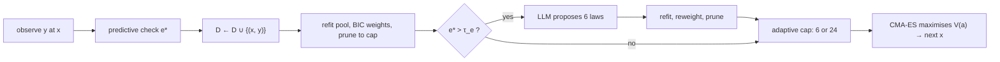
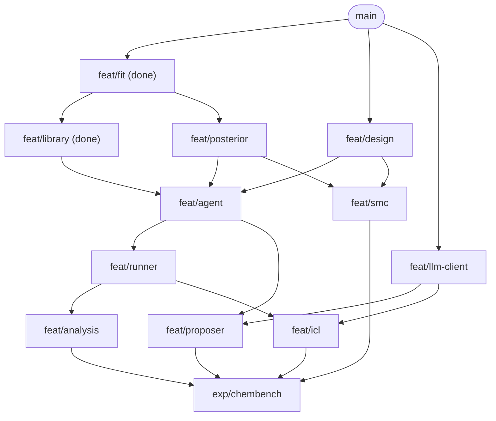

# Implementation blueprint

This blueprint lists what remains to reproduce the Model Discovery Agent (MDA) experiment on ChemBench ([arXiv:2608.09696v5](https://arxiv.org/abs/2608.09696), §4.1 and App. B), and which branch implements each part. [chembench-spec.md](./chembench-spec.md) gives the paper's settings and our defaults where the paper is silent (D1–D19); this file refers to it as "spec §n".

**In scope:**

- the primary MDA arm (hybrid seed library + LLM, BIC weights, CMA-ES design);
- the fixed-library, random-design, fixed-scale-BIC and SMC controls;
- both ICL baselines;
- pass rates and nMSLE curves that can be compared with the paper.

**Out of scope:**

- GlucoseBench, NeuronBench and BoxingGym;
- particle filters and synthetic likelihoods, which only latent dynamics need;
- rerunning LLM-AutoSciLab ([api-cost-estimation.md](./api-cost-estimation.md) explains why).

## Current state

This is `main` with `feat/fit` and `feat/library` merged.

| Module | Contents | Merged in |
| --- | --- | --- |
| `mda.bench` | `World` (`observe`, `truth`, `heldout`), `to_unit` and `from_unit`, benchmark constants | `feat/chembench` (#1) |
| `mda.metrics` | `rmsle`, `nmsle`, `passed` | `feat/chembench` (#1) |
| `mda.arrays` | jaxtyping aliases | `feat/chembench` (#1) |
| `mda.hypothesis` | `Hypothesis`, `Param`, `Model`, `compile_hypothesis`, `parse_hypotheses` | `feat/hypothesis` (#4), `feat/fit` (#8) |
| `mda.fit` | `fit` and `FitResult`, `sigma`, `residuals`, `relative_residuals`, `residual_input_spearman` | `feat/fit` (#8) |
| `mda.library` | `SEED_LIBRARY`, the 9 seed laws with the D7 bounds, and `SEED_BY_WORLD`, mapping each canonical world to its seed | `feat/library` |
| `prompts/chem_propose.txt` | The proposer prompt, verbatim from App. G.1 | — |
| CI | pre-commit, ty, and pytest on Python 3.12 and 3.13 | `dev/ci` (#2), `dev/ty` (#3) |
| Tooling | ty as a pre-commit hook, and the Development section of the README | `dev/ty-precommit` (#5) |

## Target layout

```text
src/mda/
  bench.py, metrics.py, arrays.py, hypothesis.py, fit.py, library.py   done
  pool.py       feat/posterior    Candidate and Pool: fitted hypotheses, dedupe, refit, diagnostics
  posterior.py  feat/posterior    BIC (profiled and fixed scale), weights, top-N pruning, adaptive cap
  design.py     feat/design       V(a), CMA-ES and random design
  config.py     feat/agent        MDAConfig: every hyperparameter, each citing the paper or a D-number
  agent.py      feat/agent        MDAAgent: init, design, update_state, get_model, get_predictor (Alg. 2)
  propose.py    feat/agent        Proposer protocol and NullProposer
                feat/proposer     LLMProposer: prompt rendering, parse, dedupe, retry
  llm.py        feat/llm-client   Claude client wrapper, reply cache, transcripts, usage and cost
  run.py        feat/agent        run_cell: Alg. 1 for one (world, seed), with a JSON run log
                feat/runner       grid over worlds × seeds × arms, CLI, resume, manifest
  smc.py        feat/smc          tempered-SMC evidence (control arm)
  icl.py        feat/icl          ICL (+MDA design) and ICL (+LLM design)
  analysis.py   feat/analysis     aggregation, world bootstrap, figures and tables
configs/        frozen arm configs (feat/runner, exp/chembench)
runs/, cache/   generated run logs and LLM replies; git-ignored
```

One `update_state` call, in the primary arm:



## Branch plan



There are three tracks, which can proceed in parallel:

- **Numerics:** `feat/fit` and `feat/library` (done) → `feat/posterior`, with `feat/design` alongside → `feat/agent` → `feat/runner`. `feat/posterior` can start now.
- **LLM:** `feat/llm-client` can start now. `feat/proposer` waits for `feat/agent`.
- **Evaluation:** `feat/analysis`, `feat/icl` and `feat/smc` start once the run-log schema from `feat/agent` is fixed.

| # | Branch | Scope | Depends on | Milestone |
| --- | --- | --- | --- | --- |
| 1 | `feat/fit` (done) | Bounded multistart least squares and residual diagnostics | main | M1 |
| 2 | `feat/library` (done) | The 9 canonical seed laws | `feat/fit` | M1 |
| 3 | `feat/posterior` | Pool, BIC, weights, pruning, adaptive cap | `feat/fit` | M1 |
| 4 | `feat/design` | $V(a)$, CMA-ES, random design | main | M1 |
| 5 | `feat/agent` | MDA agent loop, predictive check, one-cell runner | 2, 3, 4 | M1 |
| 6 | `feat/runner` | Grid runner, CLI, arm configs | 5 | M1 |
| 7 | `feat/llm-client` | Claude wrapper, reply cache, cost accounting | main | M2 |
| 8 | `feat/proposer` | LLM proposer and the hybrid arm | 5, 7 | M2 |
| 9 | `feat/analysis` | Aggregation, bootstrap, figures | 6 | M3 |
| 10 | `feat/icl` | ICL baselines | 6, 7 | M3 |
| 11 | `feat/smc` | Tempered-SMC control | 3, 4 | M3 |
| 12 | `exp/chembench` | Frozen configs, full runs, results write-up | 8, 9, 10, 11 | M4 |

### 1. `feat/fit` (done)

- **Scope.** `mda/fit.py`, as built:
  - `sigma(y)`: the whitening scale $\max(0.03\lvert y\rvert, 0.01)$.
  - `residuals(y, y_hat, residual)`: the residuals whose squares sum to the RSS, `"whitened"` by default or `"log1p"` (D1).
  - `fit(h, X, y, *, rng, n_starts, warm_start, residual, f)` → `FitResult(theta, rss, y_hat, ok)`, using bounded multistart `scipy.optimize.least_squares` (spec §3, D8). A parameter with `low > 0` whose bounds span more than two decades is optimised, and its starts are drawn, in log space. One with `low == high` is held fixed. `f` takes an already compiled hypothesis, so that a refit does not compile it again.
  - `relative_residuals(y, y_hat, c)` (D5).
  - `residual_input_spearman(X, y, y_hat)`: the residual–input Spearman correlations used in the prompt (D6), one per input in the order of `INPUT_NAMES`. A correlation is 0 when the input or the residual is constant, and all seven are NaN when any residual is non-finite.
  - `Model`, the type of a compiled hypothesis, added to `mda/hypothesis.py`.
- **Constants.** $\rho$, $\sigma_{\mathrm{floor}}$, $c$ and the two-decade threshold are module constants of `mda/fit.py` (`RHO`, `SIGMA_FLOOR`, `REL_FLOOR`, `LOG_SPAN`) until `feat/agent` adds `MDAConfig`.
- **Dependencies.** `scipy`, added with `uv add`.
- **Tests.** `tests/test_fit.py` covers the five cases planned for this branch, then the starts and the error handling:
  - Recovers known constants from noiseless Michaelis–Menten and Hill data.
  - Never leaves the bounds.
  - Non-finite predictions give `ok=False` and `rss=inf` instead of raising.
  - Deterministic for a given RNG; a warm start is used when given.
  - The all-zero $D_0$ of the activator worlds (`c67`, `c78`, `c92`) does not crash.
  - Starts for wide bounds are drawn in log space, random starts rescue a stuck warm start, and ties go to the warm start.
  - Linear-space parameters raise no warnings, and caller errors raise instead of returning `ok=False`.
- **Measured.** A seed law fits on 25 points in tens of milliseconds: about 40 ms at the median, with 8 random starts and a warm start.

### 2. `feat/library` (done)

- **Scope.** `mda/library.py`, as built:
  - `SEED_LIBRARY`: a tuple of the 9 `Hypothesis` objects in spec §2, with the D7 bounds as module constants (`KCAT`, `K_MM`, `HILL_N`, `EA`).
  - `SEED_BY_WORLD`: a read-only mapping from each canonical world ID to its seed, in the order of `canonical_worlds()`.
  - The parameter names are the vendored oracle's, so fitted values compare with a world's constants by name.
- **Tests.** `tests/test_library.py`:
  - All 9 compile, and their names and expressions are unique.
  - Each canonical world's `v0`/medium constants fall within the bounds. This checks the bounds; it is not used to tune them.
  - Each seed at its world's constants reproduces `World.truth`.
  - Fitting each seed to 25 noiseless `World.truth` points (8 random starts) gives RMSLE < 0.05 on `heldout(42, 1000)`.
- **Done when** the fixed-library arm can represent all 9 canonical worlds.

### 3. `feat/posterior`

- **Scope.**
  - `mda/pool.py`: `Candidate` (hypothesis, compiled function, fit, origin: `seed`, `init` or `expand@B`) and `Pool`, with exact-expression dedupe (D13), refit of everything on $D$, and the per-candidate median relative residual.
  - `mda/posterior.py`: `bic_profiled` with the RSS floor (D2), `bic_fixed`, `log_prior(lam)`, `weights`, `prune_top(n)`, and `adaptive_cap(weights, fit_err)` returning 6 or 24 (spec §3–4).
  - Models with non-finite RSS get weight 0 and are pruned first.
- **Tests.**
  - BIC values against hand computation.
  - Weights sum to 1, and their order is consistent with BIC.
  - $\mathrm{RSS} = 0$ does not produce NaN.
  - Pruning keeps the largest weights.
  - The cap thresholds behave correctly just above and below 0.9 and 0.05.
  - Dedupe ignores formatting but treats a renamed parameter as a new expression.
- **Done when** `Pool.refit(D)` followed by `weights` reproduces Alg. 9 for both BIC variants.

### 4. `feat/design`

- **Scope.** `mda/design.py`:
  - `between_model_variance(U, weights, predictors)`, vectorised over a batch of unit-box designs (spec §6, D9). It depends only on weights and callables, not on `Pool`, so the branch can start from `main`.
  - `cma_design(..., rng, n_evals=48)` (D10).
  - `random_design(rng)`.
- **Dependencies.** `uv add cma`.
- **Tests.**
  - $V = 0$ when all models agree or one model has weight 1, and $V \ge 0$ otherwise.
  - Exactly 48 objective evaluations, with the result inside the bounds.
  - On a toy two-model pool that disagrees only at high $C_A$, the design moves to high $C_A$.
  - Deterministic for a given seed.
- **Done when** a design takes less than a second for a 24-model pool.

### 5. `feat/agent`

- **Scope.**
  - `mda/config.py`: `MDAConfig`, one dataclass with every value in spec §1–6 and D1–D15. Each field has a comment citing the paper or a D-number. It takes over `RHO`, `SIGMA_FLOOR`, `REL_FLOOR` and `LOG_SPAN` from `mda/fit.py`. `fit` and `residuals` do not yet accept $\rho$, $\sigma_{\mathrm{floor}}$ or the threshold as arguments, so they change here too.
  - `mda/propose.py`: the `Proposer` protocol, `propose(kind, pool, D, budget_left) -> list[Hypothesis]`, plus `NullProposer`.
  - `mda/agent.py`: `MDAAgent` implementing Alg. 2, with the predictive check (both variants, D5), $R_m$ and $N_e^{\max}$ gating (D4), adaptive cap and pruning, a current-data MAP `get_model`, and a plug-in `get_predictor`.
  - `mda/run.py`: `run_cell(world, seed, config, proposer) -> RunLog` (Alg. 1). It evaluates RMSLE on the 1000-point grid, nMSLE on the 60-point query set (D11) and pass, at every $B$ from 3 to 25. The JSON run log records, per step: $x$, $y$, $e^*$, whether the pool expanded, the cap, and a pool snapshot (expression, $\hat\theta$, RSS, BIC, weight, origin), plus the LLM call IDs.
- **Tests.**
  - With `NullProposer`, the pool never expands.
  - With a fake proposer, the pool expands exactly when $e^* > \tau_e$, respecting $R_m$, $N_e^{\max}$ and the cap.
  - The run log has 23 evaluation points and survives a JSON round trip.
  - A smoke run on `c0_michaelis_menten` with the fixed library passes at $B = 25$.
- **Done when** one cell runs end to end with no API calls.

### 6. `feat/runner`

- **Scope.**
  - The CLI: `mda-impl run --arm {hybrid,fixed,random,fixed-tau,...} --worlds ... --seeds 0,1,2 --out runs/<arm>`.
  - Multiprocessing across cells, resuming by skipping completed cells, and a manifest recording the git SHA, config hash, package versions and model ID.
  - Arm configs in `configs/`, with `runs/` and `cache/` added to `.gitignore`.
- **Tests.**
  - The CLI runs a 2-cell grid.
  - Resume skips completed cells.
  - Each arm config loads.
- **Done when** milestone M1 is reached (below).

### 7. `feat/llm-client`

- **Scope.** `mda/llm.py`:
  - `LLMClient.complete(system, user, *, schema=None) -> Reply(text, usage, stop_reason, request_id)` on the Anthropic SDK: `claude-haiku-5-5` with `output_config={"effort": "medium"}`, plus an optional structured-output schema (D15).
  - An on-disk reply cache (D17) and JSONL transcripts.
  - Usage-to-cost accounting, and a `FakeLLM` for tests.
  - The official `count_tokens` measurement for the proposer prompt, which closes the TODO in [api-cost-estimation.md](./api-cost-estimation.md).
- **Tests.**
  - A cache hit makes no network call.
  - `max_tokens` and `refusal` stop reasons are surfaced.
  - Cost arithmetic.
  - No test calls the real API.
- **Done when** a single real call made by hand succeeds and is cached.

### 8. `feat/proposer`

- **Scope.** `LLMProposer` in `mda/propose.py`:
  - Renders the init and expand prompts. The template follows `chem_propose.txt`: the init prompt has no refining section, and the expand prompt adds the refining section and the budget/phase line, filled in as described in D6.
  - Then `parse_hypotheses`, dedupe against the pool, and a cap at $N$ (12 at init, 6 per expansion), with the retry policy of D14.
  - Wiring for the `hybrid` arm.
- **Tests.**
  - Snapshot tests of the rendered prompts.
  - Parsing, dedupe and capping with `FakeLLM`.
  - Retry on unusable replies, and fallback to the seeds when the initial batch is empty.
- **Pilot.** Run the hybrid arm on about 6 worlds × 1 seed. Record tokens and cost, and update [api-cost-estimation.md](./api-cost-estimation.md) with the measured numbers before the full run.
- **Done when** milestone M2 is reached.

### 9. `feat/analysis`

- **Scope.** `mda/analysis.py` and `mda-impl report`:
  - Load run logs, aggregate (seed mean within world, geometric mean over worlds), 5,000-replicate world-bootstrap CIs, paired ratios (D19), and pass rates over all 171 cells (spec §7).
  - Figures: nMSLE against $B$ per arm (Fig. 2a), the posterior storyboard of one cell (Fig. 2b), fixed vs hybrid (Fig. 6), and CMA-ES vs random for each backend (Fig. 7).
- **Dependencies.** `uv add matplotlib`, or a `--group analysis` dependency group.
- **Tests.**
  - Aggregation on a toy set of run logs matches hand computation.
  - The bootstrap is reproducible for a given seed.
  - Infinite errors are handled as spec §7 describes.

### 10. `feat/icl`

- **Scope.** `mda/icl.py` and the ICL prompts in `prompts/` (D16):
  - **ICL (+MDA design)** replays the MDA run logs. For every $B$, it makes one request predicting the 60 query rates. The histories are fixed, so this goes through the Message Batches API at half price.
  - **ICL (+LLM design)** starts from $D_0$, lets the LLM choose 22 conditions, and predicts at every $B$.
- **Tests.**
  - Prompt rendering.
  - Parsing predictions and design replies, with the retry and fallback paths, using `FakeLLM`.

### 11. `feat/smc`

- **Scope.** `mda/smc.py`:
  - Adaptive-tempering SMC per Alg. 6, with 100 particles per structure, random-walk Metropolis that rejects out-of-bounds proposals, and the D18 settings.
  - $p(m) \propto e^{-2C_m}$.
  - $\bar\mu_m(a)$ averaged over particles in $V(a)$.
  - A `--arm smc` config.
- **Tests.**
  - On a one-parameter toy model, $\log Z$ matches numerical quadrature.
  - The ESS stays at or above $\eta N$ after each rung.
  - Particles never leave the bounds.

### 12. `exp/chembench`

- **Scope.** This branch holds no library code. It records:
  - the frozen configs for every arm;
  - the commands used;
  - summary CSVs and figures;
  - `docs/results-chembench.md`, which compares our numbers side by side with the paper's (spec §8) and explains the deviations: the LLM model, the cohort, and every D-default that matters.
- **Raw data.** Raw run logs stay out of git.

## Milestones

| Milestone | Reached when | Check against the paper |
| --- | --- | --- |
| M1: MDA without an LLM | The fixed-library arm runs on all 171 cells with no API cost | Every canonical-world cell passes at $B = 15$ (Fig. 6) |
| M2: Hybrid MDA | The pilot's cost is measured, then all 171 cells run | Pass rate near 74.9% at $B = 20$ and 78.4% at $B = 25$. The pool trajectory looks like Fig. 2b: expansions are rare and the cap drops to 6 once the fit is adequate |
| M3: Baselines and controls | The random-design, fixed-scale-BIC, SMC and ICL arms run | Hybrid minus fixed pass rate at $B = 15$ is about +33 points. The CMA-ES/random nMSE ratio is below 1 under both backends. ICL is worse than MDA |
| M4: Write-up | `docs/results-chembench.md` is merged | Every number in spec §8 is reproduced, or the difference is explained |

The paper's numbers come from GPT-5.6-Luna, and ours from Claude Haiku 5.5, so matching the trends and orders of magnitude is the realistic target. Matching to the last digit is not.

## Conventions

- **Branches.** `feat/<name>` for library code, `dev/<name>` for tooling and docs, `exp/<name>` for experiment runs and results. Each branch is cut from `main` after its dependencies merge, and becomes one PR into `main` with CI green (pre-commit, ty, pytest).
- **Commits.** Messages start with `add:`, `update:`, `fix:` or `rm:`, as in the existing history.
- **Hyperparameters.** Every hyperparameter lives in `MDAConfig`, never inline, with a comment citing the paper location or a D-number from the spec. When a default changes, update the spec in the same PR.
- **Tests.** Tests never call the Claude API; use `FakeLLM` or a fake `Proposer`. Array-typed functions use the jaxtyping aliases in `mda.arrays`, so pytest checks shapes at run time.
- **Dependencies.** Add them with `uv add`, in the branch that first needs them: `scipy` (`feat/fit`, added), `cma` (`feat/design`), `matplotlib` (`feat/analysis`).
- **Vendored code.** `src/mda/_vendor` stays identical to upstream.

## Cost and compute

- **API.** The hybrid arm makes at most 23 proposer calls per cell (1 at initialisation and up to 22 expansions, D4), over 171 cells. The estimate in [api-cost-estimation.md](./api-cost-estimation.md) stands until the M2 pilot replaces it with measured usage. Only the fixed-library arm makes no calls. The random-design, fixed-scale-BIC and SMC controls make their own expansion calls; the paper's fixed-scale arms reuse the paired arm's initialisation reply (Fig. 7 caption) instead of making a new call.
- **CPU.** Each update refits at most 24 models with 9 starts each (8 random starts and a warm start) on at most 25 points, and runs 48 CMA-ES evaluations of $V(a)$. A seed law fits in about 40 ms, so refitting a full pool takes about a second, and longer when the laws have more parameters. This is cheap, so parallelise across cells, not within them. SMC costs about 100 particles × rungs × moves per model per update, which is why the paper limits it to a 12-world cohort (D12).
